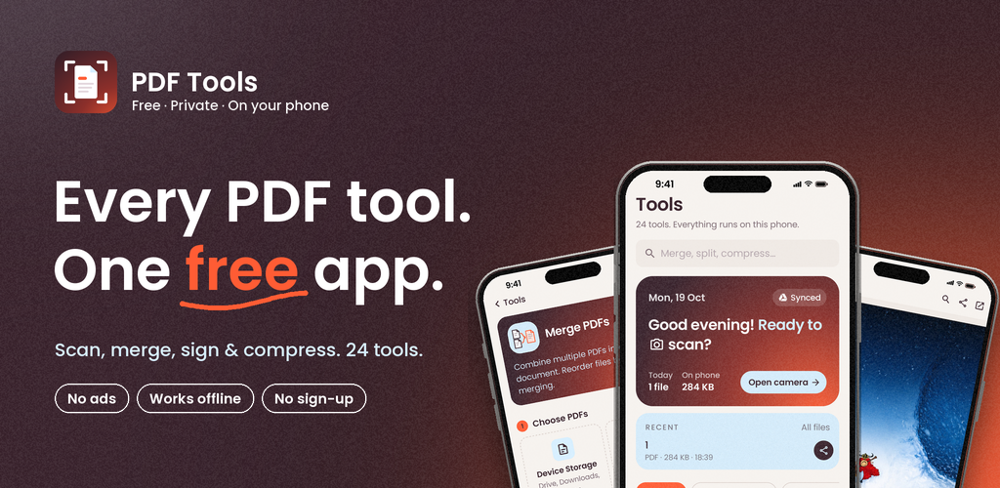
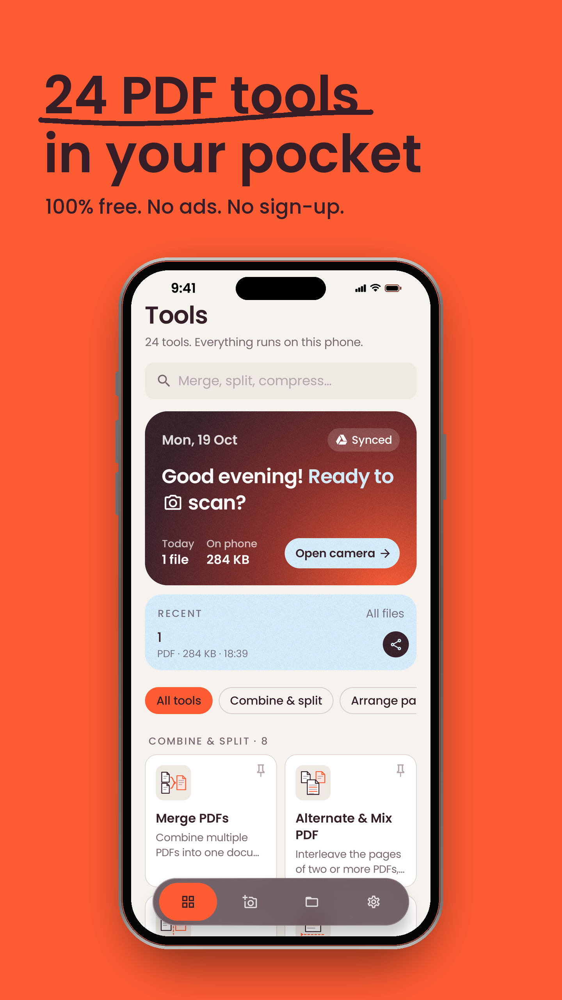
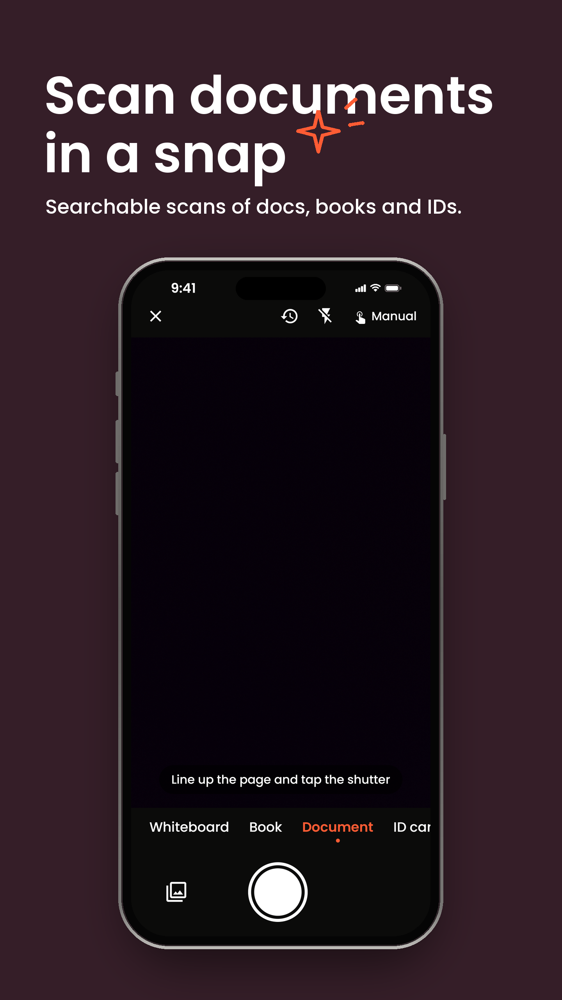
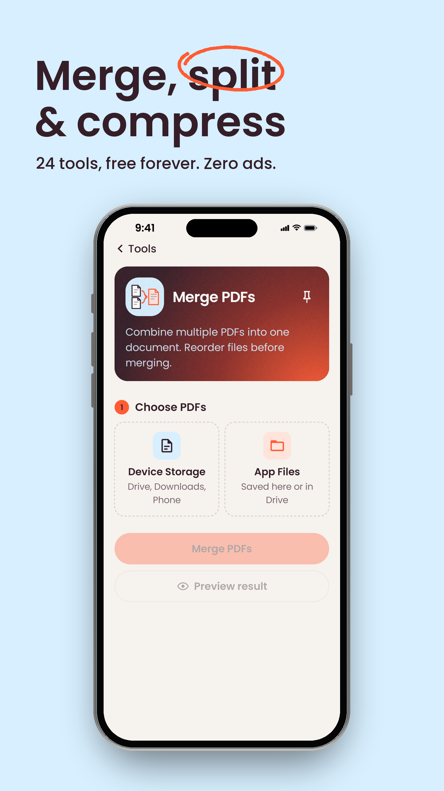
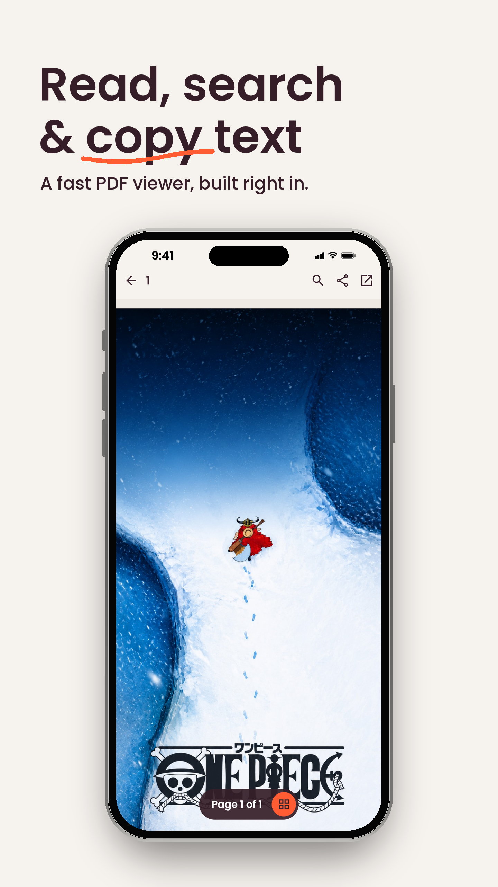
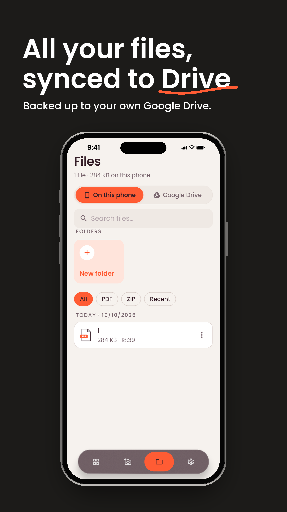
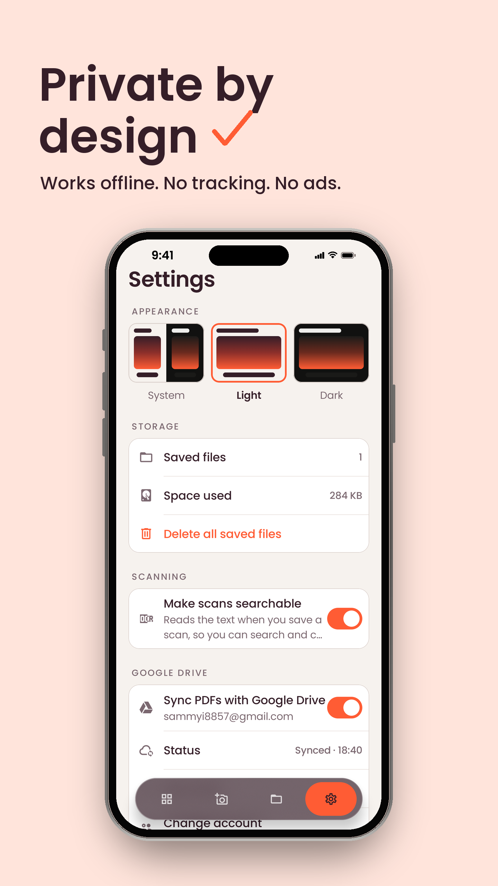

<p align="center">
  
</p>

<h1 align="center">PDF Tools</h1>

<p align="center">
  24 free PDF tools and a document scanner for Android.<br>
  Everything runs on your phone. No ads, no sign-up, no tracking.
</p>

<p align="center">
  <a href="https://github.com/sammyZi/pdf-tools/releases/latest"><b>⬇ Download the latest APK</b></a>
  &nbsp;·&nbsp;
  <a href="https://github.com/sammyZi/pdf-tools/releases">All releases</a>
  &nbsp;·&nbsp;
  <a href="https://sammyzi.github.io/pdf-tools/">Privacy policy</a>
</p>

<p align="center">
  <a href="https://github.com/sammyZi/pdf-tools/releases/latest"></a>
  
  
  
  
  
  
  <a href="https://github.com/sammyZi/pdf-tools/releases"></a>
  
</p>

## Download

Grab an APK from the [latest release](https://github.com/sammyZi/pdf-tools/releases/latest):

| File | For |
|---|---|
| `app-universal-release.apk` | Any phone. Not sure? Use this one. |
| `app-arm64-v8a-release.apk` | Most phones from the last several years (64-bit). Smallest download. |
| `app-armeabi-v7a-release.apk` | Older 32-bit ARM phones. |

Needs Android 7.0 or newer. The built-in PDF viewer needs Android 12 with the latest system updates; on other phones PDFs open in
your PDF app instead. The APKs are signed with the app's upload key; a copy installed from Google Play is signed with a different key, so remove one before installing the other.

## Screenshots

| | | |
|:-:|:-:|:-:|
|  |  |  |
|  |  |  |

## Features

### Scan
- Camera scanner with live page-edge detection, auto or manual capture, flash, and front or back camera.
- Modes for documents, books (two pages per shot), ID cards (front and back on one page), business cards and whiteboards.
- Crop, rotate, filters (auto colour, light text, grayscale, whiteboard), brightness and contrast.
- Cleanup and markup brushes with any colour, including one picked straight off the page.
- Saved scans are searchable: on-device OCR adds an invisible text layer you can search and copy.

### 24 tools
| Group | Tools |
|---|---|
| Combine & split | Merge · Alternate & Mix · Split · Split by Text · Split by Bookmarks · Split in Half · Split by Size · PDF to ZIP |
| Arrange pages | Organize (reorder, rotate, delete) · Rotate · Flip · Multiple Pages per Sheet · Crop & Resize |
| Fill & mark up | Fill & Sign (with a drawn, saved signature) · Watermark · Page Numbers · Redact · Edit PDF Details |
| Protect & shrink | Compress (by level, or to fit a size) · OCR · Set Password · Remove Password |
| Automate | Workflow Builder: chain any tools and run them on one or many PDFs |

Pin the tools you use most to the top of Home. Every tool can preview its result before saving.

### Read
- Built-in viewer: smooth scrolling and zoom, select and copy text, search with highlights, links, page thumbnails,
  jump to page and a fast scroller. Password-protected PDFs open with their password.

### Files and Google Drive
- Folders, search, rename, move, share, and save a copy to any folder or as Word or JPEG.
- Optional two-way sync with a "PDF Tools" folder in your own Google Drive (`drive.file` scope: the app only sees
  what it created). Download, rename and delete Drive folders from the app.

### Design
- Light and dark themes in Tangerine, Black Cherry and Cool Blue, with grainy-gradient surfaces and a frosted tab bar.

## Privacy

Every tool, the scanner and OCR run on the device. Files leave the phone only if you turn on Google Drive sync, and
then only to your own Drive. There are no ads, no analytics and no account.

## Tech stack

| | |
|---|---|
| Language and UI | Kotlin, Jetpack Compose, Material 3, Navigation Compose |
| PDF engine | [PdfBox-Android](https://github.com/TomRoush/PdfBox-Android), Android `PdfRenderer` |
| Viewer | [Jetpack PDF](https://developer.android.com/jetpack/androidx/releases/pdf) (`androidx.pdf`) |
| Scanner | CameraX, OpenCV with a bundled DocAligner model, ZXing (QR codes) |
| OCR | ML Kit Text Recognition (on-device) |
| Sync | Google Identity authorization, Drive REST API v3 |
| Blur | [Haze](https://github.com/chrisbanes/haze) |

## Build

Requirements: JDK 17 and the Android SDK (compile SDK 36 with SDK extension 19). Android Studio works too.

```bash
./gradlew :app:assembleDebug        # debug APK in app/build/outputs/apk/debug
./gradlew :app:installRelease       # release build on a connected phone
```

Release signing reads your upload key from `~/.gradle/gradle.properties` (never the repo):

```properties
PDF_TOOLS_UPLOAD_STORE_FILE=/path/to/upload.jks
PDF_TOOLS_UPLOAD_STORE_PASSWORD=…
PDF_TOOLS_UPLOAD_KEY_ALIAS=…
PDF_TOOLS_UPLOAD_KEY_PASSWORD=…
```

Without it, release builds are signed with the debug key. Google Drive sync needs an Android OAuth client for the
package name and your signing SHA-1 in Google Cloud.

## Releases

Releases are built locally with the upload key (an APK per ABI plus a universal one, in `app/build/outputs/apk/release`)
and attached to a GitHub release with the `gh` CLI. `./gradlew :app:bundleRelease` builds the Play Store bundle.

```bash
./gradlew :app:assembleRelease -PallAbis
gh release create v2.1.0 app/build/outputs/apk/release/*.apk --title "PDF Tools v2.1.0"
```

## Tests

```bash
./gradlew :app:testReleaseUnitTest                          # page geometry (JVM)
./gradlew :app:connectedDebugAndroidTest -PsideBySide       # every tool, the viewer and pins, on a phone
```

`-PsideBySide` installs the test build as a separate app (`com.sammyi57.pdftools.test`), so a run never touches
your real files.

## Project layout

```
app/src/main/java/com/sammyi57/pdftools/
  Theme.kt, Kit.kt          palette, type and shared components
  Tools.kt                  the tool catalogue
  Pdf.kt, PdfRender.kt      PDF engine
  ToolScreen.kt, PageEditors.kt
  Scanner.kt, Review.kt, ScanModel.kt, DocCamera.kt, DocVision.kt
  Viewer.kt                 in-app viewer
  Storage.kt, Files.kt, Backup.kt
store-screenshots/          Play Store images
```

## Privacy policy

The privacy policy and terms are published at **https://sammyzi.github.io/pdf-tools/** (built from the app's own text). Contact: [bhingesamarth@gmail.com](mailto:bhingesamarth@gmail.com).

## Credits

Built with Jetpack Compose, Jetpack PDF, CameraX, PdfBox-Android, OpenCV, ML Kit, and the DocAligner page-detection
model, among others. See [THIRD_PARTY_NOTICES.md](THIRD_PARTY_NOTICES.md) for every project and its licence.

## License

[MIT](LICENSE) © 2026 SammyZi
